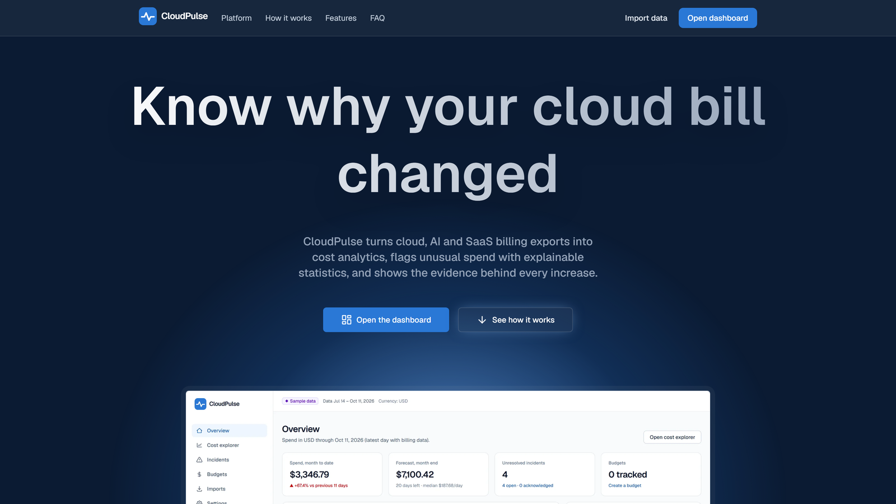
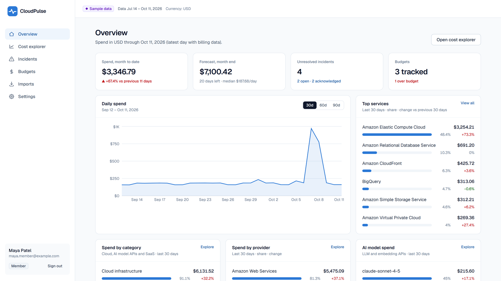
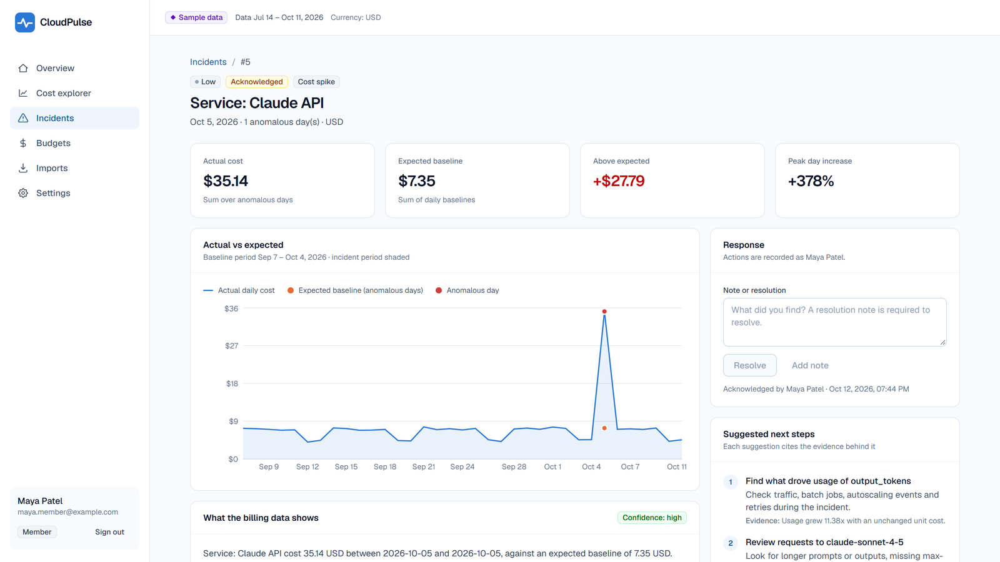
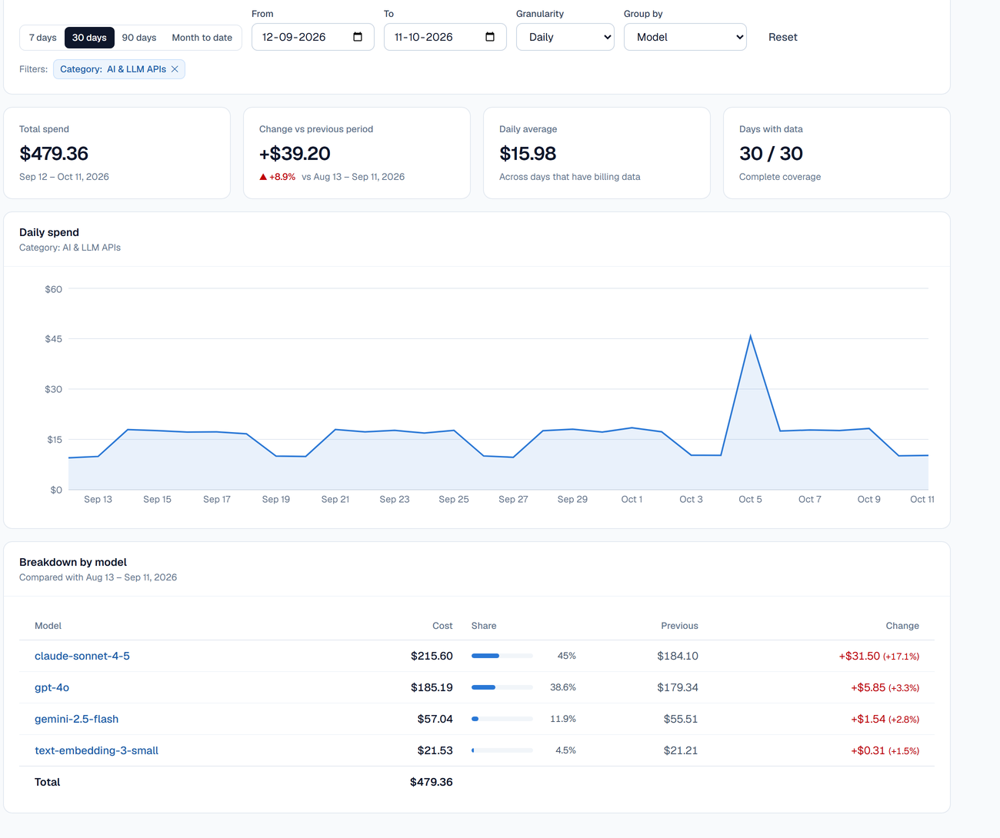
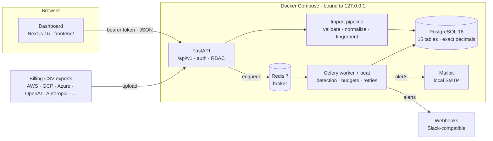

<div align="center">


<h1>CloudPulse</h1>

<p><strong>Know why your cloud bill changed.</strong> A FinOps (Cloud Financial Operations) platform for cloud, AI and SaaS spend.<br>
CloudPulse turns billing exports into cost analytics, detects unusual spend with explainable statistics,
and shows the evidence behind every increase.<br>
It runs on your machine: one API, one database and one dashboard, with no cloud account or paid service needed.</p>

<p>
  
  
  
  
  
  
  
  
  
  
  
</p>

<p>
  <a href="#getting-started"><b>Getting started</b></a> ·
  <a href="#architecture"><b>Architecture</b></a> ·
  <a href="#routes">Routes</a> ·
  <a href="docs/api.md">API reference</a> ·
  <a href="docs/anomaly-detection.md">How detection works</a> ·
  <a href="docs/design.md">Design system</a>
</p>

</div>

> [!NOTE]
> **Built by Aakash Agrahari** as a student engineering project. Every number in the built-in dataset is **synthetic sample data**,
> and the dashboard shows a *Sample data* badge wherever it is loaded. CloudPulse reads billing **exports**: it never calls a cloud
> provider, creates resources or sends your data to an external AI service.

<p align="center">
  
  
</p>
<p align="center">
  
  
</p>

---

## Contents

| Section |
| --- |
| [What is FinOps?](#what-is-finops) · [Overview](#overview) · [Stack](#stack) · [Architecture](#architecture) |
| [Getting started](#getting-started) · [Environment](#environment) · [Scripts](#scripts) |
| [Project structure](#project-structure) · [Routes](#routes) |
| [Data model](#data-model) · [Roles and permissions](#roles-and-permissions) · [Accounts](#accounts) |
| [Numbers you can defend](#numbers-you-can-defend) · [Quality](#quality) · [Brand](#brand) · [Limitations](#known-limitations) · [Roadmap](#roadmap) |

## What is FinOps?

**FinOps (Cloud Financial Operations)** is the practice of making engineering, finance and product teams jointly accountable for
cloud spend. Its loop has three phases, and CloudPulse covers each one for a small team:

| FinOps phase | Question | Where CloudPulse answers it |
| --- | --- | --- |
| **Inform** | Where is the money going, and who owns it? | Imports from every provider, one canonical cost model, breakdowns by provider, category, service, model, project and environment, allocation rules for untagged spend |
| **Optimize** | What changed, and why? | Anomaly detection with stored evidence, investigations that separate usage-driven from price-driven increases, suggestions tied to that evidence |
| **Operate** | How do we stay on track? | Budgets with forecasts and threshold alerts, an incident workflow (acknowledge, note, resolve), roles and an audit log |

Most FinOps tools are SaaS products that need read access to your cloud accounts. CloudPulse is the opposite trade-off: local-first,
open, and built around exports you already have.

## Overview

| Area | What it does |
| --- | --- |
| **Billing ingestion** | CSV upload with size, encoding, header and per-row validation. Errors are reported by line and column, and nothing is imported if any row is invalid. AWS Cost and Usage Report column names are recognised; identical files are rejected and duplicate records skipped |
| **Every provider** | AWS, Google Cloud, Microsoft Azure, Oracle, Alibaba, DigitalOcean, Cloudflare, OpenAI, Anthropic, Google Gemini, Mistral, DeepSeek, Hugging Face, Datadog, Snowflake, Databricks, MongoDB Atlas and any other provider that exports CSV. Names like "Microsoft Azure" are normalized and grouped into **cloud**, **AI** and **SaaS** |
| **AI and LLM spend** | An optional `model` column with token counts as usage: group and filter by model (`gpt-4o`, `claude-sonnet-4-5`), budget an AI category, and investigate token spikes like any other incident |
| **Cost analytics** | Totals, daily, weekly and monthly series, breakdowns by any dimension compared with the previous period, and a month-end forecast from the trailing 7-day median |
| **Cost allocation** | Rules attribute untagged costs to projects and environments (by provider, account, service, resource, region, usage type or model) |
| **Anomaly detection** | Same-weekday or rolling **median** baselines, robust z-scores, percentage, amount and new-spend thresholds, and a minimum-history rule. Every decision is stored with its evidence |
| **Investigation** | Largest contributors by dimension, new resources and regions, usage-versus-price analysis, deterministic explanations with a confidence statement, and suggestions that cite their evidence |
| **Incidents** | Consecutive anomalous days become one incident; acknowledge, add notes, resolve and reopen, with a full timeline. Re-running detection never duplicates an incident |
| **Budgets and alerts** | Monthly, quarterly or yearly budgets for all spend or one scope, with utilization and projection. Alerts go out by e-mail or webhook (Slack-compatible), once per threshold per period, and every delivery is logged and retried |
| **Security** | Sign-in with first-run admin setup, three roles, scrypt-hashed passwords, revocable sessions, lockout after failed logins, an audit log and request IDs on every response |
| **Dashboard** | Landing page, overview, cost explorer, incidents, investigation, budgets, imports and settings, with loading, empty, error and success states, down to 360 px wide |

## Stack

| Layer | Choice | Notes |
| --- | --- | --- |
| Dashboard | **Next.js 16** (App Router), React 19 | `frontend/`; TypeScript strict, Tailwind CSS 4, Recharts 3, shadcn/ui for the landing hero |
| API | **FastAPI** + Pydantic 2 | `backend/`; versioned under `/api/v1`, one error format, OpenAPI docs at `/docs` |
| Data access | **SQLAlchemy 2** + Alembic | Money is `NUMERIC(18,8)`, returned as decimal strings, never floats |
| Parsing | **pandas** | CSV validation and normalization |
| Database | **PostgreSQL 16** | Advisory locks keep concurrent detection runs from duplicating incidents |
| Jobs | **Celery 5** on **Redis 7** | Detection every 6 h, budgets hourly, delivery retries every 10 min, expired sessions purged daily |
| E-mail | **Mailpit** | Local SMTP inbox, so alerts can be tested without a mail server |
| Tests | **pytest**, **Playwright** | The backend suite runs against a real PostgreSQL; e2e drives a real browser |
| Runtime | **Docker Compose** | Every port bound to `127.0.0.1` |

## Architecture



Three things follow from that shape:

- **Every number comes from one place.** Analytics, detection, investigations and budgets all read the same canonical
  `billing_records` table, so the overview, an incident and a budget can never disagree about what was spent.
- **The statistics are deterministic.** There is no language model in the loop: the same billing data always produces the
  same incidents, explanations and suggestions, and every detection stores the values and thresholds it used.
- **Providers and categories are data.** A new provider is just a new value in the `provider` column; the category mapping
  lives in one registry (`backend/app/services/providers.py`) and is applied in SQL.

More detail: [docs/architecture.md](docs/architecture.md).

## Getting started

Prerequisites: [Docker Desktop](https://www.docker.com/products/docker-desktop/) running, and Git.

```powershell
git clone <your-repo-url> CloudPulse
cd CloudPulse
Copy-Item .env.example .env                    # then set POSTGRES_PASSWORD in .env
docker compose --profile app up -d --build     # database, Redis, Mailpit, API, worker, scheduler, dashboard
```

| Open | URL |
| --- | --- |
| Dashboard | http://localhost:3000 |
| API docs (OpenAPI / Swagger) | http://127.0.0.1:8000/docs |
| Local e-mail inbox (Mailpit) | http://127.0.0.1:8025 |

Then follow the demo:

1. **Create the admin account.** The first visit shows a one-time setup form.
2. **Imports → Load sample data.** 90 days of cloud, AI and SaaS spend ending yesterday; detection runs automatically.
3. **Overview** and **Cost explorer.** Spend by category, provider and AI model; filter to *AI & LLM APIs* and group by *Model*.
4. **Incidents.** Open the *Claude API* spike: output tokens grew 11.4× and cost grew with them, so it is usage-driven.
5. **Budgets → New budget** ($3,000 monthly), then **Check budgets now**. The alert arrives in Mailpit.

Stop everything with `docker compose --profile app down`. Your data stays in Docker volumes (never add `-v`, which deletes them).

**Developing with hot reload.** Run only the infrastructure in Docker and the API and dashboard on your machine:

```powershell
docker compose up -d                           # postgres, redis, mailpit
cd backend; .\.venv\Scripts\Activate.ps1
alembic upgrade head; uvicorn app.main:app --host 127.0.0.1 --port 8000
cd ..\frontend; npm install; npm run dev       # http://localhost:3000
```

Full setup, tests and Windows troubleshooting: [docs/development.md](docs/development.md).

### Environment

Copy `.env.example` to `.env` (git-ignored). Only `POSTGRES_PASSWORD` is required; everything else has a local default.

| Variable | Default | What it is |
| --- | --- | --- |
| `POSTGRES_PASSWORD` | *(required)* | Database password used by Compose and the API |
| `POSTGRES_HOST` · `POSTGRES_PORT` · `POSTGRES_DB` · `POSTGRES_USER` | `127.0.0.1` · `5432` · `cloudpulse` · `cloudpulse` | Database connection |
| `REDIS_URL` | `redis://127.0.0.1:6379/0` | Celery broker and results |
| `SESSION_TTL_HOURS` · `AUTH_MAX_FAILED_LOGINS` · `AUTH_LOCKOUT_MINUTES` | `12` · `5` · `15` | Session length and lockout policy |
| `CORS_ORIGINS` | `["http://localhost:3000","http://127.0.0.1:3000"]` | Browser origins allowed to call the API |
| `MAX_UPLOAD_BYTES` | `20971520` (20 MB) | Upload limit |
| `SMTP_HOST` · `SMTP_PORT` · `SMTP_FROM` | `127.0.0.1` · `1025` · `cloudpulse@localhost` | Alert e-mail (Mailpit locally) |
| `NEXT_PUBLIC_API_URL` | `http://127.0.0.1:8000` | API origin for the dashboard (`frontend/.env.local` when running locally) |

### Scripts

| Where | Command | What it does |
| --- | --- | --- |
| root | `docker compose --profile app up -d --build` | Run the whole stack |
| `backend/` | `pytest` | Backend tests against the `cloudpulse_test` database |
| `backend/` | `ruff check . && ruff format --check .` | Lint and formatting |
| `backend/` | `alembic upgrade head` | Apply database migrations |
| `backend/` | `python -m scripts.generate_sample_data` | Regenerate the synthetic CSV |
| `backend/` | `python -m scripts.manage_users create-admin` · `reset-password` | Create an admin or recover a password from the server |
| `frontend/` | `npm run dev` · `npm run build` | Dev server · production build |
| `frontend/` | `npm run lint` · `npm run typecheck` | ESLint · TypeScript |
| `frontend/` | `npm run test:e2e` | Playwright end-to-end tests (use a throwaway database) |

## Project structure

```text
backend/                   FastAPI app, Celery worker, Alembic migrations, tests
  app/api/v1/              REST routes (versioned under /api/v1)
  app/core/                settings, logging, error envelope, security, request IDs
  app/models/              SQLAlchemy models
  app/schemas/             Pydantic request/response models
  app/services/            ingestion, normalization, providers, analytics, anomaly_detection,
                           investigation, budgeting, notifications, audit, auth, pipeline
  app/workers/             Celery app and scheduled tasks
  alembic/versions/        migrations 0001–0004
  scripts/                 sample-data generator, user management CLI
  tests/                   pytest suite (real PostgreSQL)
frontend/                  Next.js 16 dashboard and landing page
  src/app/                 routes (landing, login, dashboard/*)
  src/components/          features/, charts/, shell/, ui/, brand/
  src/lib/                 API client, auth token, formatting, hooks
  e2e/                     Playwright tests
sample-data/               synthetic 90-day CSV and a deliberately invalid CSV
docs/                      architecture, API, schema, detection, design, development, screenshots
docker-compose.yml         postgres, redis, mailpit; api, worker, beat, frontend under the "app" profile
```

## Routes

**Dashboard** · http://localhost:3000

| Route | What |
| --- | --- |
| `/` | Landing page: hero with the live dashboard, provider strip, how it works, features, FAQ |
| `/login` | Sign in, or the one-time admin setup on an empty workspace |
| `/dashboard` | Overview: month to date, forecast, incidents, budgets, spend by category, provider and AI model |
| `/dashboard/costs` | Cost explorer (`?group=model&category=ai`, any dimension as a filter, date presets) |
| `/dashboard/incidents` · `/dashboard/incidents/[id]` | Incident list · investigation, evidence and response workflow |
| `/dashboard/budgets` | Budgets, utilization, projections and threshold alerts |
| `/dashboard/imports` | CSV upload with validation, sample data, import history, canonical format |
| `/dashboard/settings` | Account, detection thresholds, notification channels, allocation rules, users, audit log |

**API** · http://127.0.0.1:8000/api/v1 (full reference in [docs/api.md](docs/api.md))

| Area | Endpoints |
| --- | --- |
| Health | `GET /health` · `GET /ready` (checks the database and Redis) |
| Auth | `GET /auth/status` · `POST /auth/setup` · `POST /auth/login` · `GET /auth/me` · `POST /auth/logout` · `POST /auth/change-password` |
| Users and audit | `GET/POST /users` · `PATCH /users/{id}` · `POST /users/{id}/reset-password` · `GET /audit-events` |
| Imports | `POST /imports` · `POST /imports/sample` · `GET /imports` · `GET/DELETE /imports/{id}` · `GET /imports/schema` · `GET /imports/template.csv` |
| Costs | `GET /costs/data-status` · `/costs/summary` · `/costs/timeseries` · `/costs/breakdown` · `/costs/forecast` |
| Allocation | `GET/POST /allocation-rules` · `PUT/DELETE /allocation-rules/{id}` |
| Detection | `GET/PUT /anomalies/settings` · `GET/POST /anomalies/runs` |
| Incidents | `GET /incidents` · `GET /incidents/counts` · `GET /incidents/{id}` · `GET /incidents/{id}/investigation` · `POST /incidents/{id}/acknowledge` · `/resolve` · `/reopen` · `/notes` |
| Budgets | `GET/POST /budgets` · `GET/PUT/DELETE /budgets/{id}` · `POST /budgets/evaluate` · `GET /budgets/alerts` |
| Notifications | `GET/POST /notifications/channels` · `PUT/DELETE /notifications/channels/{id}` · `POST /notifications/channels/{id}/test` · `GET /notifications/deliveries` |

## Data model

Fifteen tables in PostgreSQL, created by Alembic migrations `0001`–`0004`. Details: [docs/database-schema.md](docs/database-schema.md).

| Group | Tables |
| --- | --- |
| Billing | `billing_imports`, `billing_records` (one canonical row per cost line: provider, account, service, resource, region, usage type, `model`, quantity, currency, cost, project, environment) |
| Allocation | `allocation_rules` |
| Detection | `detection_settings`, `detection_runs`, `anomaly_detections`, `incidents`, `incident_events` |
| Budgets and alerts | `budgets`, `budget_alerts`, `notification_channels`, `notification_deliveries` |
| People and trust | `users`, `user_sessions`, `audit_events` |

`category` (cloud, AI, SaaS, other) is computed from `provider` in SQL, so changing the provider registry re-categorizes existing
data without a migration. Records carry a SHA-256 **fingerprint**, so overlapping exports never double-count.

## Roles and permissions

One workspace, three roles. Every API route declares the role it needs, and a test calls every route as anonymous, viewer,
member and admin to prove it.

| Role | Can |
| --- | --- |
| **Admin** | Everything a member can do, plus detection settings, notification channels, allocation rules, deleting imports, users and roles, and the audit log |
| **Member** | Import billing data, run detection, acknowledge, note, resolve and reopen incidents, create and edit budgets |
| **Viewer** | Read every dashboard, breakdown and investigation. Actions are hidden in the UI and refused by the API (`403 forbidden`) |

Passwords are hashed with scrypt; sessions are opaque bearer tokens stored only as hashes, expire after 12 hours and are revocable.
Five failed sign-ins lock an account for 15 minutes.

## Accounts

There are **no default passwords**. On an empty database the first visit to the dashboard creates the admin account, and that admin
adds members and viewers under **Settings → Users**. A forgotten admin password is recovered on the server:

```powershell
cd backend
python -m scripts.manage_users reset-password --email you@example.com   # prompts for the new password
```

The Playwright suite creates its own throwaway admin (`e2e-admin@example.com`) in a separate test database.

## Numbers you can defend

CloudPulse's promise is "no invented causes", and the code follows it:

- **Exact money.** Amounts are stored as decimals and returned as decimal strings; floating point is never used for money.
- **One currency at a time.** Different currencies are never added together without a conversion rate.
- **Missing is not zero.** Days without billing data are gaps in every chart and are excluded from averages and forecasts.
- **No verdict without history.** A series needs a minimum history before any day can be called anomalous; otherwise the run says so.
- **Evidence, not guesses.** Explanations are fixed templates filled with measured values. When the data cannot support a conclusion, CloudPulse says "the cause cannot be determined".
- **Sample data is labelled.** A *Sample data* badge appears wherever synthetic data is loaded.

## Quality

| Check | Coverage |
| --- | --- |
| **pytest** | 205 backend tests against a real PostgreSQL: parsing, providers, analytics, detection, incidents, investigations, budgets, notifications, auth and an access-policy test over every route |
| **Playwright** | 15 end-to-end tests: sign-in and setup, CSV validation, analytics and AI spend drill-down, the incident workflow, budgets, viewer restrictions, the landing page and reduced motion |
| **Static checks** | ruff, ESLint, TypeScript strict, `alembic check` |
| **CI** | GitHub Actions (`.github/workflows/ci.yml`): secret scan, backend, frontend build, e2e and Docker builds on every push |

## Brand

| Token | Hex | Use |
| --- | --- | --- |
| Brand blue | `#2a78d6` | Primary buttons, links, active navigation, chart series 1 |
| Brand blue (hover) | `#1c5cab` | Primary hover |
| Ink | `#0b1b33` | Landing hero, headings on light |
| Good | `#0ca30c` | Within budget, delivered, decreases |
| Warning | `#fab219` | Medium severity, budget warning |
| Serious | `#ec835a` | High severity |
| Critical | `#d03b3b` | Critical severity, over budget, failures |

Type is Geist (UI) and Geist Mono (identifiers). Status colours always come with a text label, and every chart has a table
of values next to it. Read [docs/design.md](docs/design.md) before any UI work.

## Known limitations

- **Single workspace.** All users share one set of billing data; separate organizations (multi-tenancy) are not implemented.
- **Built for local use.** Services bind to `127.0.0.1` and there is no HTTPS. A network deployment would need TLS, a hardened CORS list and rate limiting at a reverse proxy.
- **Exports, not live connectors.** Costs arrive as CSV files. Pulling from AWS Cost Explorer, the OpenAI or Anthropic usage APIs needs real credentials and is a future step.
- **No currency conversion.** Each currency is analysed separately.
- **Increases only.** Detection flags cost increases; days already recorded as anomalous are not withdrawn if the data later changes.
- Ingestion runs synchronously in the upload request (about 7 s to validate 150,000 rows); very large exports should be split.

See [docs/anomaly-detection.md](docs/anomaly-detection.md#limitations) for detection-specific limitations.

## Roadmap

| When | Milestone |
| --- | --- |
| **Built** | Ingestion, multi-provider and AI cost model, analytics, allocation, detection, investigation, incidents, budgets, alerts, auth and RBAC, audit log, CI |
| **Next** | Live connectors: AWS CUR from S3, Cost Explorer API, OpenAI and Anthropic usage APIs (bring your own keys) |
| **Next** | Unit economics: cost per customer, feature or 1,000 requests from tagged spend |
| **Later** | Multi-tenant workspaces, SSO, cookie sessions behind HTTPS |
| **Later** | Commitment insights: savings plans and reserved capacity coverage from billing data |

## Documentation

| Document | Contents |
| --- | --- |
| [docs/architecture.md](docs/architecture.md) | Components, data flow, design decisions |
| [docs/database-schema.md](docs/database-schema.md) | Tables, relationships, constraints, migrations |
| [docs/api.md](docs/api.md) | Every endpoint with example requests |
| [docs/anomaly-detection.md](docs/anomaly-detection.md) | Detection and investigation logic, tuning, limitations |
| [docs/design.md](docs/design.md) | Design system: colour, type, components, charts |
| [docs/development.md](docs/development.md) | Local setup, tests, troubleshooting on Windows |
| [sample-data/README.md](sample-data/README.md) | The synthetic dataset and its three injected anomalies |

<div align="center">
<sub>Made with ♥ by Aakash Agrahari · CloudPulse, FinOps for cloud and AI spend</sub>
</div>
